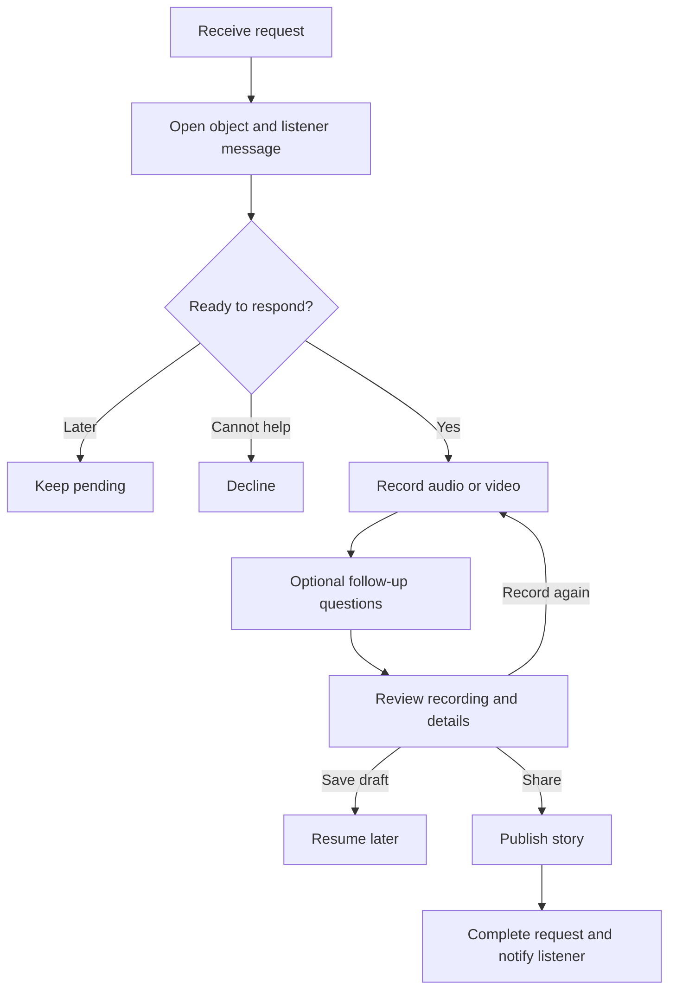

Family Object Stories — UI Workflow & Implementation Brief
1. Product goal
Let family members capture meaningful objects, discover existing family stories, and request new stories from relatives who know their history.
Example: A grandchild photographs a watch. Their grandfather receives the photo, records who gave him the watch and why it matters, and shares the recording. The grandchild is notified when the story is ready.
Role
Responsibility
Listener — User 1
Captures an object; requests, watches, or listens to its story.
Storyteller — User 2
Receives a request and records the object's story.

A person can use both roles. Do not create separate account types.
Object recognition proposes matches; the listener confirms them. Search only within the authorized family archive. An archive error must not be treated as proof that no story exists.
3. Listener screens
A. Home
Primary heading: Discover an object's story
Primary button: Open camera
Other destinations:
Family stories: Browse completed stories.
My requests: View pending and completed requests.
Tell a story: Record without waiting for a request.
Notifications: View incoming requests and ready stories.
Keep the camera action prominent in every display mode.
B. Capture
Show a live camera preview and square framing guide.
Instruction: Place the object inside the frame.
Control
Behavior
Photo / Video
Switch capture mode; Photo is the default.
Capture
Take a photo or start video recording.
Stop
Finish video recording.
Switch camera
Toggle front and rear cameras.
Upload instead
Choose an existing photo or video.
Back
Return to the previous screen.

Video captures audio. Show elapsed time and a recording indicator. Use a configurable limit; 60 seconds is a proposed MVP default.
Request camera access when opening capture and microphone access when selecting video. If camera access is denied, offer permission guidance and Upload instead. If microphone access is denied, explain the requirement and offer Photo mode.
C. Review capture
Show the photo or a playable video preview with sound.
Heading: Can you see the object clearly?
Retake: Return to capture.
Use photo / Use video: Approve and continue.
Allow full video replay. If automated quality detection is available, flag blur or poor lighting with a short message, such as This looks a little blurry. Try taking it again. Allow the user to continue anyway. Otherwise, rely on manual review.
D. Search family archive
After approval:
Upload the capture.
Save its media record.
Search for the same object within the family archive.
Check for a published story or existing request.
Loading message: Looking for this object's story…
Result
Behavior
One likely match with a story
Show its thumbnail and ask Is this the same object?
Several possible matches
Show a short list; allow None of these.
Confirmed object with pending request
Open that request's status.
Confirmed object without a story
Continue to storyteller selection.
No match
Create an object record and continue to storyteller selection.
Search failed
Offer Try again or Request a story anyway.

E. Choose storyteller
Heading: Who might know its story?
Show family members as large cards with names and photos. After selection, show the object preview, selected relative, optional short message, and Send request.
Example message: Grandpa, who gave you this watch?
If no family members are connected, offer Invite a family member and preserve the capture.
F. Request confirmation
Only show success after the request is saved.
Heading: Story requested
Message: We've asked Grandpa about this object. We'll let you know when the story is ready.
Buttons: Back to home and View request.
The request stays pending when the listener leaves the screen.
G. Story playback
Display:
Object title and image.
Storyteller's name.
Story video, or object imagery with the storyteller's recorded audio.
Play/pause, progress, volume, and captions/transcript when available.
Ask a follow-up.
Use the relative's actual recording as the primary narration. Keep any AI summary separate and approved by the storyteller.
4. Storyteller workflow

H. Incoming request
Notification: Nikesh wants to hear about your watch.
Request screen:
Large object image or playable capture.
Listener's name and message.
Primary button: Tell the story.
Secondary button: Later.
Less prominent option: I don't know this story.
For Extra simple mode, make the primary action especially prominent.
I. Record story
Default to audio recording; offer video as an alternative.
Initial prompt: Tell us about this object.
Show the object image, large Start recording button, timer, pause/resume controls, and Finish recording.
Ask optional follow-ups one at a time:
Who gave it to you?
When did you get it?
What makes it special to you?
Each prompt has Answer and Skip actions. Ask for missing details rather than repeating information already recorded. For the MVP, prompts can follow the initial recording; live conversational AI can come later.
J. Review and share
Show recording playback, editable object title, a short description of one or two sentences, and optional dates, people, and location supplied by the storyteller.
Buttons:
Share story
Record again
Save draft
AI-generated titles, transcripts, and descriptions must be editable before sharing. Do not invent missing family details.
On sharing:
Save the approved story.
Link it to the object and request.
Mark the request completed.
Notify the listener.
Success message: Your story has been shared with Nikesh.
5. Age-based display modes
During onboarding, ask for age with a horizontal slider and circular handle. Show the selected age clearly. Provide a numeric input or plus/minus controls as an accessible alternative.
Age
Default mode
Presentation
Below 18
Regular
Full navigation, visual story cards, familiar camera controls.
18–50 inclusive
Simplified
Fewer visible actions, clear labels, reduced clutter.
Above 50
Extra simple
Large text and buttons, one main action per screen, minimal navigation.

Age sets the initial display preference. Anyone can change it through Settings → Display mode. Offer Use simpler screens during onboarding. Every mode retains the complete core workflow.
Extra simple mode requirements:
Large buttons with text labels.
Plain language.
One question per screen.
Visible Back and Home controls.
No essential action hidden behind gestures.
Short descriptions with optional Read more.
Clearly visible recording controls.
6. Minimum data model
Record
Essential fields
User
id, name, age, ui_mode, family_id, avatar_url
Object
id, family_id, title, cover_media_id, created_by
Media
id, uploaded_by, type, storage_url, duration, upload_status
StoryRequest
id, object_id, capture_media_id, listener_id, storyteller_id, message, status, created_at
Story
id, object_id, request_id (optional), storyteller_id, recording_media_id, title, description, transcript, status
Notification
id, recipient_id, type, request_id, story_id, read_at, created_at

A story created without a request has no request_id. Store media files in file storage and references in the database.
States
Request: pending, in_progress, completed, declined, cancelled.
Story: draft, published.
Upload: uploading, ready, failed.

Key transitions
Event
State change
Request saved
Request → pending
Storyteller begins responding
Request → in_progress
Story saved for later
Story → draft; request remains open
Story shared successfully
Story → published; request → completed
Storyteller cannot help
Request → declined
Listener cancels an open request
Request → cancelled

7. Reliability and access requirements
Preserve approved captures and drafts when users navigate away.
Show upload progress; offer retry after failure.
Prevent duplicate requests or stories caused by repeated taps.
Keep in-app notifications available when push is disabled.
Show request status in My requests.
Let storytellers resume drafts from the request or Tell a story.
Restrict archive searches and story access to authorized family members.
If notification delivery fails, keep the saved request and retry delivery separately.
If a storyteller declines, let the listener choose another family member.
Keep errors short and provide a clear next action.
Clearly distinguish working backend features from demo placeholders.
8. Suggested implementation order
Set up user, family, object, media, request, story, and notification records.
Build photo/video capture, upload, and review.
Implement manual object selection and confirmed archive matches.
Build request creation, request status, and in-app notifications.
Build storyteller recording, drafts, review, and publishing.
Build story playback and completion notifications.
Apply the three display modes to the same functional screens.
Add AI object matching, transcription, short summaries, and follow-up prompts.
Manual matching is a development fallback; label it clearly until AI matching works.
9. MVP acceptance checklist
Listener can capture and review a photo.
Listener can capture and replay video with audio.
Retake returns to capture without submitting a request.
Confirming a known object opens its published story.
Rejecting a suggested match allows a new request.
Unknown objects can be sent to a selected storyteller.
Successful request creation shows confirmation and pending status.
Storyteller can open a request and view the captured object.
Storyteller can record, review, save a draft, and publish.
Publishing completes the request and notifies the listener.
Listener can play the completed story.
The same object can be found again without another request.
Upload and notification failures have recovery paths.
All three display modes support the full workflow.
10. AI coding handoff
Implement this brief as one connected end-to-end workflow. Use Listener and Storyteller as contextual roles on the same account. Build the screens and state transitions described above, use real persistence for captures and requests, and keep suggested object matches subject to user confirmation. Use short interface copy and reusable components for the three display modes. Implement the core recording/request/playback loop before adding optional AI enhancements.

